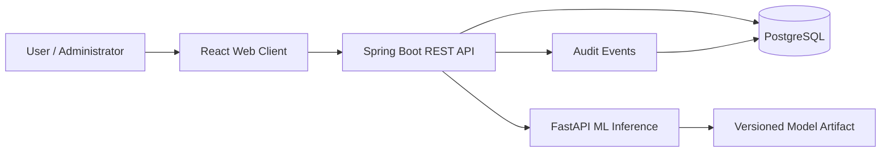

# System Architecture
## CyberSaarthi — Cybercrime Awareness and Reporting Portal
**Version:** 1.0 | **Status:** Proposed baseline

## 1. Architecture Goals

- Separate user interface, core business logic, persistence, and ML inference.
- Keep Spring Boot as the authoritative application backend and system of record.
- Isolate Python model-serving dependencies in FastAPI.
- Allow report submission to succeed when ML inference is temporarily unavailable.
- Make model and taxonomy versions traceable.
- Support a two-member academic team without unnecessary infrastructure complexity.

## 2. Proposed Technology Stack

| Layer | Technology | Responsibility |
|---|---|---|
| Web client | React | User, awareness, reporting, tracking, and admin UI |
| Core backend | Java + Spring Boot | Authentication, authorisation, workflows, validation, APIs |
| ML service | Python + FastAPI | Model loading and inference |
| Database | PostgreSQL | Users, reports, content, assessments, audit records, prediction metadata |
| API documentation | OpenAPI/Swagger | Contract visibility and testing |
| Testing | JUnit/Spring tests, pytest, frontend tests | Unit, integration, contract, and UI verification |
| Version control | Git | Source and documentation history |

Specific library and version choices should be recorded in a separate implementation decision log after compatibility checks.

## 3. High-Level Architecture



The React client communicates with Spring Boot. The client must not call the ML service directly. Spring Boot validates the request, persists the report, and orchestrates inference. FastAPI receives only the minimum text and metadata required for classification.

## 4. Component Responsibilities

### 4.1 React web client
- Public awareness pages and official guidance.
- Registration and login screens.
- Incident report form and confirmation.
- User report list, detail, and status history.
- Quiz interface and feedback.
- Admin review queue, content management, and aggregate dashboard.
- Display ML suggestions with an advisory explanation.

### 4.2 Spring Boot application
Suggested logical modules:
- `auth`: registration, login, session/token handling, role checks.
- `users`: profile and account operations.
- `awareness`: topic and content retrieval/management.
- `assessment`: quizzes and attempts.
- `reports`: report submission, ownership, tracking, state transitions.
- `classification`: FastAPI client, prediction persistence, retry/failure handling.
- `admin`: review queue and privileged workflows.
- `analytics`: aggregate queries and controlled exports.
- `audit`: immutable-style event recording for sensitive changes.
- `common`: shared validation, errors, configuration, and utilities.

Use controller → service → repository boundaries. Controllers should remain thin; business rules belong in services.

### 4.3 FastAPI ML service
- Load a versioned model artifact and preprocessing pipeline once at startup.
- Expose health and prediction endpoints.
- Validate text length and request schema.
- Return predicted category, model version, taxonomy version, and score semantics.
- Avoid database writes to the application database.
- Avoid logging raw report text.
- Provide a deterministic response contract for the Spring client.

### 4.4 PostgreSQL
Stores application records and metadata. Spring Boot owns writes and transaction boundaries. The ML service does not connect directly to the production application database.

## 5. Main Runtime Flows

### 5.1 Report submission
1. React sends report details to Spring Boot.
2. Spring validates identity, ownership context, fields, and consent/purpose acknowledgements.
3. Spring persists the report with `SUBMITTED` or `CLASSIFICATION_PENDING`.
4. Spring calls FastAPI with minimal text and taxonomy version.
5. FastAPI returns prediction metadata.
6. Spring stores the prediction record and updates the report workflow.
7. React displays reference number and current status.

If FastAPI is unavailable, Spring retains the report and marks classification pending. A retry mechanism or administrator review can process it later.

### 5.2 Awareness assessment
1. React retrieves published quiz content from Spring.
2. User submits answers.
3. Spring validates the attempt and calculates score server-side.
4. Spring stores the attempt according to the privacy policy.
5. React displays score and learning feedback.

### 5.3 Administrator review
1. Admin UI requests paginated queue.
2. Spring verifies role and applies permitted filters.
3. Admin reviews report and prediction.
4. Spring validates state transition and category correction.
5. Spring writes report update, status history, and audit event transactionally.

## 6. API Boundary (Initial Proposal)

| Method | Path | Purpose | Access |
|---|---|---|---|
| POST | `/api/v1/auth/register` | Register user | Public |
| POST | `/api/v1/auth/login` | Authenticate | Public |
| GET | `/api/v1/awareness/topics` | List published topics | Public |
| GET | `/api/v1/awareness/topics/{id}` | Topic detail | Public |
| GET | `/api/v1/quizzes/{id}` | Retrieve quiz | Public/auth policy to finalise |
| POST | `/api/v1/quizzes/{id}/attempts` | Submit attempt | Authenticated |
| POST | `/api/v1/reports` | Submit report | Authenticated |
| GET | `/api/v1/reports` | List current user's reports | Authenticated |
| GET | `/api/v1/reports/{id}` | Report detail | Owner or authorised admin |
| GET | `/api/v1/reports/{id}/history` | Status history | Owner or authorised admin |
| GET | `/api/v1/admin/reports` | Review queue | Admin |
| PATCH | `/api/v1/admin/reports/{id}` | Review/update report | Admin |
| POST | `/api/v1/admin/awareness/topics` | Create topic | Admin |
| GET | `/api/v1/admin/analytics/summary` | Aggregate summary | Admin |

Exact request/response schemas, pagination conventions, error codes, and authentication mechanism must be defined in API contracts before implementation.

## 7. ML Service Contract (Initial Proposal)

- `GET /health`: service and model readiness.
- `POST /v1/classify`: classify one incident description.

Example request:
```json
{
  "text": "I received a message asking me to verify my bank account through a link.",
  "taxonomy_version": "1.0"
}
```

Example response:
```json
{
  "predicted_category": "Phishing and Social Engineering",
  "score": 0.82,
  "score_type": "uncalibrated_model_score",
  "model_version": "baseline-logreg-1",
  "taxonomy_version": "1.0",
  "requires_manual_review": false
}
```

The numeric value above is illustrative only, not a measured result. The score type must reflect the actual model. Thresholds must be selected using validation data and documented. If the model cannot provide a meaningful probability, return a decision score or omit probability language.

## 8. Reliability and Failure Design

- Report persistence must happen before or independently of inference.
- Use explicit connection and read timeouts for FastAPI calls.
- Handle service unavailable, timeout, invalid response, and model-not-ready states.
- Do not silently convert inference failure into a confident category.
- Make retry operations idempotent.
- Keep a record of model version and inference outcome.
- Provide an admin path for manual categorisation.

## 9. Security Architecture

- Enforce role and record ownership on the backend.
- Keep secrets in environment variables or a managed secret store.
- Apply HTTPS in deployed environments.
- Configure CORS narrowly.
- Rate-limit public authentication and report endpoints.
- Validate and constrain all input.
- Use safe database access and migration tooling.
- Keep audit records for administrative changes.
- Do not expose internal ML endpoints publicly unless required and protected.
- Avoid storing unnecessary evidence files in the MVP.

## 10. Deployment View

For local development, run React, Spring Boot, FastAPI, and PostgreSQL as separate processes/services. Use environment-specific configuration and documented startup commands.

For demonstration deployment, deploy the web client and backend services with TLS and controlled database access. The ML artifact must be versioned and deployed with its matching preprocessing metadata. Do not commit secrets or large model files unless the repository policy explicitly permits them.

## 11. Architecture Decisions to Record

Create an Architecture Decision Record (ADR) whenever a material choice is made. Initial decisions to confirm:
1. Authentication strategy and token/session storage.
2. Database migration tool.
3. Synchronous inference versus background processing.
4. Model artifact format and registry/version convention.
5. Evidence upload policy (recommended: defer from MVP).
6. Hosting and deployment topology.
7. Logging, retention, and deletion policy.

## 12. Quality Attributes and Trade-offs

A modular monolith in Spring Boot plus a separate FastAPI inference service is preferred over multiple microservices. This reduces operational overhead while preserving the Python ML boundary. The architecture can evolve if measured scale or research requirements justify it.
