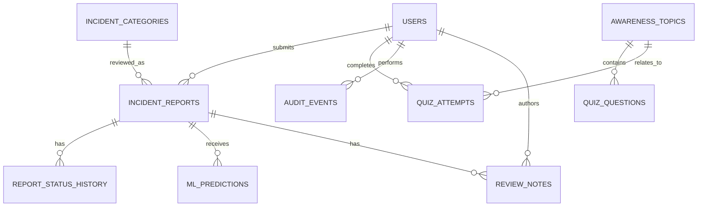

# Database Design
## CyberSaarthi — Proposed PostgreSQL Schema
**Version:** 1.0 | **Status:** Logical baseline; validate before migrations

## 1. Design Principles

- PostgreSQL is the application system of record.
- Spring Boot owns application database writes.
- Use primary keys, foreign keys, constraints, and indexes to protect integrity.
- Store only data necessary for stated product and research purposes.
- Keep original ML suggestions distinct from human-reviewed categories.
- Version taxonomy and model metadata.
- Avoid storing sensitive evidence in the initial release.

The following is a logical design, not a final physical schema. Exact column types, naming conventions, retention, and migration scripts must be reviewed before implementation.

## 2. Entity Relationship Overview

## 3. Tables

### 3.1 `users`
| Column | Suggested type | Constraints / notes |
|---|---|---|
| `id` | UUID | Primary key |
| `email` | VARCHAR(254) | Unique; normalised |
| `password_hash` | VARCHAR(255) | Never store plaintext |
| `display_name` | VARCHAR(120) | Required; validate |
| `account_status` | VARCHAR(20) | e.g. ACTIVE, DISABLED |
| `created_at` | TIMESTAMPTZ | Required |
| `updated_at` | TIMESTAMPTZ | Required |

### 3.2 `roles` and `user_roles`
`roles`: `id`, `code` (unique), `description`.  
`user_roles`: `user_id`, `role_id`, `assigned_at`, `assigned_by`; composite primary key. Prevent public self-assignment of privileged roles.

### 3.3 `awareness_topics`
| Column | Suggested type | Notes |
|---|---|---|
| `id` | UUID | Primary key |
| `slug` | VARCHAR(160) | Unique |
| `title` | VARCHAR(200) | Required |
| `summary` | VARCHAR(500) | Required |
| `body_markdown` | TEXT | Sanitise/render safely |
| `topic_category` | VARCHAR(80) | Controlled vocabulary |
| `publication_status` | VARCHAR(20) | DRAFT, PUBLISHED, ARCHIVED |
| `created_by` | UUID | FK users |
| `updated_by` | UUID | FK users |
| `created_at` / `updated_at` | TIMESTAMPTZ | Required |
| `published_at` | TIMESTAMPTZ | Nullable |

### 3.4 `quiz_questions`
Suggested fields: `id UUID PK`, `topic_id UUID FK`, `question_text TEXT`, `options JSONB` or normalised option table, `correct_option_key VARCHAR(30)`, `explanation TEXT`, `question_version INTEGER`, `is_active BOOLEAN`, timestamps.

For more rigorous assessment, prefer normalised `quiz_options` rows rather than embedding answer options in JSONB. Do not expose the correct answer in the public quiz response before submission.

### 3.5 `quiz_attempts`
Suggested fields: `id UUID PK`, `user_id UUID FK`, `topic_id UUID FK`, `study_subject_id UUID NULL`, `assessment_phase VARCHAR(20)`, `score INTEGER`, `max_score INTEGER`, `answers JSONB`, `started_at TIMESTAMPTZ`, `submitted_at TIMESTAMPTZ`.

`assessment_phase` may be `PRACTICE`, `PRE_TEST`, or `POST_TEST`. Store research linkage only after ethics approval and with a pseudonymous identifier. Consider a separate table for per-question answers if detailed analysis is needed.

### 3.6 `incident_categories`
Suggested fields:
- `id UUID PK`
- `taxonomy_version VARCHAR(30)`
- `code VARCHAR(80)`
- `display_name VARCHAR(160)`
- `description TEXT`
- `is_active BOOLEAN`
- `created_at TIMESTAMPTZ`

Unique constraint: (`taxonomy_version`, `code`). Do not hard-delete categories referenced by historical reports or predictions.

Initial category codes may be:
- `FINANCIAL_UPI_FRAUD`
- `PHISHING_SOCIAL_ENGINEERING`
- `IDENTITY_THEFT`
- `SOCIAL_ACCOUNT_COMPROMISE`
- `CYBERSTALKING_HARASSMENT`
- `JOB_INVESTMENT_SCAM`
- `MALWARE_RANSOMWARE`
- `OTHER_UNCLASSIFIED`

### 3.7 `incident_reports`
| Column | Suggested type | Notes |
|---|---|---|
| `id` | UUID | Primary key |
| `reference_code` | VARCHAR(32) | Unique, non-sequential public reference |
| `user_id` | UUID | FK users |
| `description` | TEXT | Limit length; sensitive data warning |
| `incident_date` | DATE | Nullable/approximate |
| `incident_channel` | VARCHAR(80) | Controlled or validated value |
| `user_selected_category_id` | UUID | Nullable FK |
| `reviewed_category_id` | UUID | Nullable FK |
| `current_status` | VARCHAR(40) | Controlled state |
| `submitted_at` | TIMESTAMPTZ | Required |
| `updated_at` | TIMESTAMPTZ | Required |
| `closed_at` | TIMESTAMPTZ | Nullable |

Do not put full names, account numbers, OTPs, or unnecessary identifiers in the report description by design. Consider a retention/deletion policy for narrative text.

### 3.8 `ml_predictions`
Suggested fields: `id UUID PK`, `report_id UUID FK`, `predicted_category_id UUID FK`, `model_name VARCHAR(100)`, `model_version VARCHAR(80)`, `taxonomy_version VARCHAR(30)`, `score NUMERIC NULL`, `score_type VARCHAR(50)`, `requires_manual_review BOOLEAN`, `inference_status VARCHAR(30)`, `inferred_at TIMESTAMPTZ`, `error_code VARCHAR(80) NULL`.

Retain multiple prediction attempts only where useful for reproducibility and audit. Never label a score as calibrated confidence unless calibration was evaluated.

### 3.9 `report_status_history`
Suggested fields: `id UUID PK`, `report_id UUID FK`, `from_status VARCHAR(40) NULL`, `to_status VARCHAR(40)`, `changed_by UUID FK users`, `change_reason TEXT NULL`, `changed_at TIMESTAMPTZ`.

### 3.10 `review_notes`
Suggested fields: `id UUID PK`, `report_id UUID FK`, `author_id UUID FK users`, `note_text TEXT`, `visibility VARCHAR(20)` (INTERNAL or USER_VISIBLE), `created_at TIMESTAMPTZ`.

Internal notes must never be returned by user-facing endpoints.

### 3.11 `audit_events`
Suggested fields: `id UUID PK`, `actor_user_id UUID NULL FK users`, `event_type VARCHAR(100)`, `entity_type VARCHAR(80)`, `entity_id UUID NULL`, `metadata JSONB`, `ip_hash VARCHAR(128) NULL`, `created_at TIMESTAMPTZ`.

Do not store raw credentials, tokens, or unnecessary personal information in metadata. Restrict read access to audit events.

## 4. Relationships and Integrity Rules

- One user can submit many reports.
- One report can have many status-history events and prediction attempts.
- A report may have one current reviewed category and multiple historical prediction records.
- A category is tied to a taxonomy version.
- A user can complete many quiz attempts.
- Awareness topics can contain many quiz questions.
- Admin review notes must reference an existing report and author.
- Deleting a user must follow a documented retention/anonymisation policy; avoid uncontrolled cascading deletion of audit records.

## 5. Indexing Recommendations

- Unique index on normalised `users.email`.
- Unique index on `incident_reports.reference_code`.
- Index `incident_reports(user_id, submitted_at DESC)`.
- Index `incident_reports(current_status, submitted_at DESC)`.
- Index `ml_predictions(report_id, inferred_at DESC)`.
- Index `report_status_history(report_id, changed_at)`.
- Index `awareness_topics(publication_status, published_at DESC)`.
- Index `quiz_attempts(user_id, submitted_at DESC)`.

Add indexes based on query plans and observed workload rather than indexing every column.

## 6. Data Retention and Privacy

Before collecting real incident narratives, define:
- Purpose and legal/ethical basis for collection.
- Required fields and optional fields.
- Retention duration and deletion/anonymisation process.
- Who can view report text and under what circumstances.
- Whether users can request correction or deletion.
- How research exports are de-identified.
- How backups and logs handle deletion requests.

Prefer synthetic data for demonstrations. Avoid evidence uploads in the MVP unless secure file storage and lifecycle controls are implemented.

## 7. Migration and Seed Data

Use versioned database migrations. Seed only non-sensitive reference data:
- Roles.
- Approved taxonomy version and categories.
- Demo awareness topics and quiz content.
- Synthetic demonstration accounts/reports where needed.

Do not seed real personal data or production credentials. Every schema change must be a migration with a rollback or recovery plan.

## 8. Open Design Decisions

1. UUID generation strategy.
2. Whether quiz options are normalised.
3. Whether incident description edits are allowed after submission.
4. Report retention duration.
5. Whether research participant records require a separate isolated schema.
6. Whether soft deletion is required.
7. Whether status and category values use lookup tables or constrained enums.
