# Product Analysis, Workflows & UI Wireframes
## CyberSaarthi — Cybercrime Awareness and Reporting Portal
**Document Version:** 1.0 | **Phase:** Phase 1 Deliverable  
**Status:** Approved Specification for Frontend & Backend Development

---

## 1. Finalized User Roles & Permissions Matrix

In accordance with FR-01 and Section 2.1 of `SRS.md`, the system implements four distinct user classes:

| Capability / Resource | Guest (Unauthenticated) | Registered User | Administrator / Reviewer | Research Evaluator |
|---|:---:|:---:|:---:|:---:|
| Browse & Search Published Awareness Guides | ✅ | ✅ | ✅ | ✅ |
| Attempt Knowledge Quizzes & View Score | ✅ (Practice) | ✅ (Tracked) | ✅ | ✅ |
| Submit Incident Report & Receive Reference Code | ❌ | ✅ | ✅ | ❌ |
| View Own Submitted Reports & Status History | ❌ | ✅ (Owned only) | ✅ (All reports) | ❌ |
| Access Admin Review Queue & Update Status | ❌ | ❌ | ✅ | ❌ |
| Override / Confirm ML Advisory Classification | ❌ | ❌ | ✅ | ❌ |
| Add Internal Notes (Hidden from User) | ❌ | ❌ | ✅ | ❌ |
| Create, Edit & Archive Awareness Content | ❌ | ❌ | ✅ | ❌ |
| View Operational & Aggregated Dashboards | ❌ | ❌ | ✅ | ✅ (Anonymized) |
| Access De-identified Research Data Exports | ❌ | ❌ | ❌ | ✅ (Study-approved) |

---

## 2. End-to-End User Workflows

```mermaid
flowchart TD
    subgraph Public_Journey["1. Awareness & Quiz Journey"]
        A[User visits CyberSaarthi] --> B[Browse Awareness Topics]
        B --> C[Read Threat Guide & Preventive Tips]
        C --> D{Take Quiz?}
        D -- Yes --> E[Submit Quiz Answers]
        E --> F[Instant Score & Explanatory Feedback]
        D -- No --> G[Continue Browsing]
    end

    subgraph Reporting_Journey["2. Guided Incident Reporting Journey"]
        H[User Logs In] --> I[Open Report Form]
        I --> J[Read Emergency Banner & Data Minimisation Warning]
        J --> K[Enter Narrative, Date, & Optional Context]
        K --> L[Accept Non-Official Legal Disclaimer]
        L --> M[Submit Report to Spring Boot]
        M --> N[Spring Boot saves Report as SUBMITTED]
        N --> O[Spring Boot calls FastAPI ML Service]
        O -- Inference OK --> P[Save ML Prediction & Display Reference ID]
        O -- Service Offline --> Q[Set status CLASSIFICATION_PENDING & Display Reference ID]
    end

    subgraph Admin_Journey["3. Admin Review & Workflow Transition"]
        R[Admin Logs In] --> S[Open Incident Review Queue]
        S --> T[Select Report for Review]
        T --> U[Inspect User Narrative & ML Advisory Suggestion]
        U --> V{Is Category Accurate?}
        V -- Yes --> W[Confirm Suggested Category]
        V -- No --> X[Correct to Approved Category]
        W --> Y[Update Status: UNDER_REVIEW -> REVIEWED]
        X --> Y
        Y --> Z[Add Internal Review Note & Write Audit Event]
    end
```



---

## 3. UI Wireframes & Layout Blueprints

### 3.1 Global Navigation Header (All Pages)
```text
+----------------------------------------------------------------------------------------------------+
| [⚠️ NOTICE] CyberSaarthi is an academic portal. For urgent financial fraud, call 1930 / cybercrime.gov.in|
+----------------------------------------------------------------------------------------------------+
| 🛡️ CyberSaarthi           [ Awareness ]  [ Report Incident ]  [ Track Status ]   | [ Login / Register ] |
+----------------------------------------------------------------------------------------------------+
```

---

### 3.2 Landing Page / Awareness Hub (`/` & `/awareness`)
```text
+----------------------------------------------------------------------------------------------------+
| 🛡️ CyberSaarthi — Your Guide to a Safer Digital World                                               |
|                                                                                                    |
| [ Search Awareness Topics: e.g., 'UPI Scam', 'Instagram Hack' ]                      [ Search ]    |
|                                                                                                    |
| +------------------------------------------------------------------------------------------------+ |
| | 🚨 URGENT FINANCIAL FRAUD HELP                                                                 | |
| | Lost money via UPI / Netbanking in the last 2 hours? Dial 1930 immediately to freeze funds!    | |
| | Official Portal: https://cybercrime.gov.in                                                    | |
| +------------------------------------------------------------------------------------------------+ |
|                                                                                                    |
| Popular Cyber Safety Modules:                                                                      |
| +--------------------------+ +--------------------------+ +--------------------------------------+ |
| | 💳 UPI & Banking Fraud   | | 🎣 Phishing & Fake Links | | 📱 Social Media Account Takeover    | |
| | Common QR code scams,    | | Identifying smishing,    | | Instagram 2FA recovery,              | |
| | fake customer care fraud.| | courier parcel lures.    | | clone profile defense.               | |
| | [ Read Guide ] [ Quiz ]  | | [ Read Guide ] [ Quiz ]  | | [ Read Guide ] [ Quiz ]              | |
| +--------------------------+ +--------------------------+ +--------------------------------------+ |
|                                                                                                    |
| +------------------------------------------------------------------------------------------------+ |
| | Need to Document an Incident?                                                                  | |
| | Document your incident securely for structured guidance and status tracking.                   | |
| | [ Submit an Incident Report -> ]                                                               | |
| +------------------------------------------------------------------------------------------------+ |
+----------------------------------------------------------------------------------------------------+
```

---

### 3.3 Awareness Topic Detail & Interactive Quiz Screen (`/awareness/{slug}`)
```text
+----------------------------------------------------------------------------------------------------+
| [ Back to Topics ]                                                    Category: Financial Fraud    |
|                                                                                                    |
| 💳 Understanding UPI & QR Code Scams                                                               |
| Published on: Oct 2026 | Reading time: 4 mins                                                      |
|                                                                                                    |
| 1. How the Scam Works:                                                                             |
| Fraudsters share a QR code claiming they are sending you money. In reality, scanning a QR code     |
| and entering your UPI PIN ALWAYS debits money from your account.                                   |
|                                                                                                    |
| 2. Red Flags to Watch:                                                                             |
| • "Enter PIN to receive reward/refund"                                                             |
| • Pressure to complete the transfer in 5 minutes                                                   |
|                                                                                                    |
| 3. What to do if Scammed:                                                                         |
| • Call 1930 immediately within the golden hour.                                                    |
| • Block your UPI app & debit card through your bank app.                                           |
|                                                                                                    |
| -------------------------------------------------------------------------------------------------- |
| 📝 Check Your Knowledge: Take the 3-Question Practice Quiz                                         |
|                                                                                                    |
| Q1: Do you need to enter your UPI PIN to receive money in your bank account?                       |
|   ( ) Yes, always                                                                                  |
|   (o) No, UPI PIN is ONLY entered to deduct/send money                                             |
|   ( ) Only if the amount is greater than Rs. 5000                                                  |
|                                                                                                    |
| [ Submit Quiz Answers ]                                                                            |
|                                                                                                    |
| [Result Banner]: ✅ Score: 3/3 — Excellent! You understand UPI security basics.                    |
+----------------------------------------------------------------------------------------------------+
```

---

### 3.4 Incident Report Submission Form (`/reports/new`)
```text
+----------------------------------------------------------------------------------------------------+
| 🛡️ Document a Cyber Incident                                                                       |
| Step 1 of 2: Guided Documentation                                                                  |
|                                                                                                    |
| +------------------------------------------------------------------------------------------------+ |
| | ⚠️ DATA MINIMISATION & PRIVACY NOTICE                                                           | |
| | • DO NOT enter your passwords, UPI PINs, bank OTPs, or full 16-digit card numbers.              | |
| | • This report is stored within CyberSaarthi for academic support; it does NOT replace an FIR.  | |
| | • For official police complaints, report directly at cybercrime.gov.in or call 1930.            | |
| +------------------------------------------------------------------------------------------------+ |
|                                                                                                    |
| 1. Incident Description * (Min 30 chars, Max 2000 chars)                                           |
| +------------------------------------------------------------------------------------------------+ |
| | [ Textarea: Describe what happened, how the scammer contacted you, and what steps took place ] | |
| |                                                                                                | |
| +------------------------------------------------------------------------------------------------+ |
|                                                                                                    |
| 2. Approximate Date of Incident: [ DD / MM / YYYY ] (Optional)                                     |
| 3. Primary Incident Channel:     [ Dropdown: WhatsApp / SMS / Phone Call / Website / Social Media ]|
| 4. User-Selected Category:       [ Dropdown: Phishing / UPI Fraud / Identity Theft / Not Sure ]    |
|                                                                                                    |
| [x] Mandatory Acknowledgment:                                                                      |
| I understand that CyberSaarthi is an academic portal, not an official police complaint system.     |
|                                                                                                    |
| [ Cancel ]                                                             [ Submit Incident Report ]  |
+----------------------------------------------------------------------------------------------------+
```

---

### 3.5 User Report Detail & Chronological Status History (`/reports/{id}`)
```text
+----------------------------------------------------------------------------------------------------+
| Report Reference: #CS-2026-9812A                                      Current Status: [ UNDER REVIEW ]
| Submitted on: 30 Oct 2026, 14:30 IST                                                               |
|                                                                                                    |
| Description:                                                                                       |
| "Received a text message regarding electricity bill due date with an APK download link..."         |
|                                                                                                    |
| ℹ️ Advisory Categorisation:                                                                        |
| Suggested Category: Phishing and Social Engineering (Confidence: 84% - Advisory)                   |
| *Notice: Classification is advisory and subject to administrator verification.                    |
|                                                                                                    |
| -------------------------------------------------------------------------------------------------- |
| 📜 Status History Timeline:                                                                        |
|                                                                                                    |
| [●] 30 Oct 2026 14:45 — Status changed to UNDER_REVIEW (System Reviewer)                          |
|     Note: Assigned to queue for category verification.                                             |
|                                                                                                    |
| [●] 30 Oct 2026 14:30 — Status set to SUBMITTED (User)                                             |
|     Note: Report recorded in CyberSaarthi. Reference code issued.                                  |
|                                                                                                    |
| Recommended Next Steps:                                                                            |
| • If you downloaded an untrusted APK, turn on Airplane mode and uninstall the app immediately.      |
| • For financial losses, report to official portal https://cybercrime.gov.in                        |
+----------------------------------------------------------------------------------------------------+
```

---

### 3.6 Administrator Review Queue (`/admin/reports`)
```text
+----------------------------------------------------------------------------------------------------+
| 🛡️ CyberSaarthi Admin Console — Review Queue                                                       |
| Filter by Status: [ All | SUBMITTED | UNDER_REVIEW | REVIEWED ]  Taxonomy Version: 1.0            |
|                                                                                                    |
| Reference ID  | Submitted Date | Advisory Category     | Model Score | Status       | Actions      |
|---------------|----------------|-----------------------|-------------|--------------|--------------|
| CS-2026-9812A | 30 Oct 14:30   | Phishing & Soc. Eng.  | 0.84        | SUBMITTED    | [ Review ]   |
| CS-2026-9799B | 30 Oct 13:15   | Financial & UPI Fraud | 0.91        | UNDER_REVIEW | [ Review ]   |
| CS-2026-9750C | 29 Oct 18:20   | OTHER_UNCLASSIFIED    | 0.42 (Low!) | UNDER_REVIEW | [ Review ]   |
|                                                                                                    |
| -------------------------------------------------------------------------------------------------- |
| Selected Report: CS-2026-9750C                                                                     |
| Description: "My phone battery drain is high and random ads pop up after installing a game."       |
| Advisory Model Category: OTHER_UNCLASSIFIED (Score: 0.42 < 0.60 threshold)                         |
|                                                                                                    |
| Admin Action:                                                                                      |
| Verified Category: [ Dropdown: Malware and Ransomware (Corrected)      ▼ ]                         |
| Update Status to:  [ Dropdown: REVIEWED                                ▼ ]                         |
| Internal Review Note: "Clear adware behavior; reclassified from Unclassified to Malware."          |
| [ ] Make note visible to reporting user (Default: Unchecked/Internal)                              |
|                                                                                                    |
| [ Cancel ]                                                        [ Save & Commit Review Update ]  |
+----------------------------------------------------------------------------------------------------+
```

