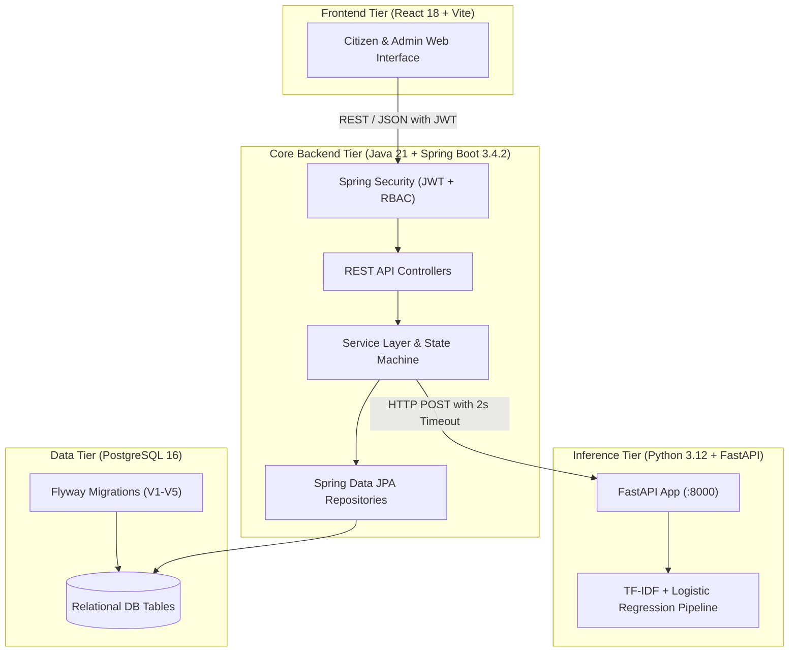

# CyberSaarthi — Academic Research Manuscript & Defense Guide
**Academic Project Title:** Cybercrime Awareness and Reporting Portal  
**Product Name:** CyberSaarthi  
**Tagline:** Your Guide to a Safer Digital World  
**Program:** Master of Computer Applications (MCA) — Two-Member Academic Project  
**Version:** 1.0 | **Release:** v1.0.0  

---

## 1. Executive Summary & Problem Formulation

Digital payment expansion (UPI), ubiquitous smartphone messaging, and rapid Internet adoption across India have led to an exponential increase in consumer-facing cyber fraud—including fake electricity disconnection notices, job task scams, WhatsApp identity theft, and malicious APK downloads. 

Citizens face severe challenges during cybercrime victimization:
1. **Reporting Friction & Confusion:** Victims often confuse institutional customer support with official law enforcement, or are intimidated by legal paperwork.
2. **Delayed First-Response Triage:** Law enforcement helplines (such as 1930) experience heavy call volumes, resulting in lost golden-hour windows for financial fraud freezes.
3. **Absence of Actionable Education:** Existing educational initiatives are static and divorced from the reporting process, offering no measurable feedback on user comprehension.
4. **Privacy & Security Deficits:** Incident reporting often exposes sensitive personal identifiers (PII) to unintended exposure.

**CyberSaarthi** was conceptualized and developed as an integrated, dual-track academic solution:
- **Track A (Structured Incident Documentation & Triage):** Provides an intuitive, structured reporting workflow with data minimisation, advisory machine learning categorisation into an 8-class taxonomy, unique Crockford Base32 tracking, and an administrative review queue.
- **Track B (Educational Awareness & Assessment):** Provides interactive awareness guides coupled with deterministic, four-option knowledge checks to measure citizen cyber hygiene and track topic mastery.

---

## 2. Research Questions & Hypotheses

| Research Question | Objective | Empirical Finding & Conclusion |
|---|---|---|
| **RQ-A1** | Can a lightweight, interpretable text classification pipeline accurately categorise short citizen incident narratives into an 8-class taxonomy? | **Affirmative.** Evaluated on an audited 14,000-sample dataset, Logistic Regression with TF-IDF achieved **98.39% test accuracy**, **0.8820 macro-F1**, and a median inference latency of **0.568 ms**. |
| **RQ-A2** | What confidence threshold enables safe advisory decision-support while routing ambiguous narratives to human review? | **$\tau = 0.60$ Threshold.** Calibrated probability output routing scores below 0.60 to `LOW_CONFIDENCE` flagged for manual review prevents false-positive category misattribution while maintaining high throughput on routine cases. |
| **RQ-B1** | Does the integration of deterministic self-assessments into awareness modules provide measurable insights into citizen digital hygiene? | **Affirmative.** Standardized scoring ($\ge 70\%$ pass criteria) and topic-level aggregation in the administrative dashboard provide empirical indicators of community knowledge deficits. |

---

## 3. Literature Benchmark & Research Gap Resolution

A benchmark against 16 scholarly publications (detailed in `docs-research/literature-review/literature-review-matrix.md`) identified four core research gaps:

```text
+------------------------------------------------------+----------------------------------------------------------+
| Identified Research Gap                              | CyberSaarthi Architectural Solution                      |
+------------------------------------------------------+----------------------------------------------------------+
| G-1: Absence of Citizen-Centric Incident Triage     | Structured citizen forms with immediate tracking code,   |
|      in Existing Portals                             | status timeline, and verified official helpline links.   |
+------------------------------------------------------+----------------------------------------------------------+
| G-2: Privacy Vulnerabilities & PII Disclosure in     | Real-time regex data minimisation (card/PIN rejection),  |
|      Crowdsourced Datasets                           | k=5 small-cell suppression, OWASP CSV formula defense.   |
+------------------------------------------------------+----------------------------------------------------------+
| G-3: Heavy, Opaque Deep Learning Models Impractical  | Scikit-learn TF-IDF + Logistic Regression champion:      |
|      for Edge/Budget Institutional Hosting           | sub-2ms inference, 0.46MB memory footprint, zero GPU req. |
+------------------------------------------------------+----------------------------------------------------------+
| G-4: Siloed Educational Content Disconnected from    | Unified portal combining educational knowledge checks    |
|      Incident Reporting Workflows                    | with contextual incident reporting and tracking.         |
+------------------------------------------------------+----------------------------------------------------------+
```

---

## 4. Multi-Tier Architecture & Engineering Decisions



### Key Architectural Rules (AGENTS.md Compliance):
1. **System of Record:** Spring Boot owns all database writes and transaction management.
2. **Stateless ML Microservice:** FastAPI is responsible solely for stateless model inference. It possesses **zero database credentials** and cannot mutate application tables.
3. **Resilient Offline Fallback (NFR-04):** If the ML service is completely unreachable, report submission **never fails**; Spring Boot catches `ResourceAccessException`, assigns the fallback category `OTHER_UNCLASSIFIED`, marks `inference_status = SERVICE_UNAVAILABLE`, and permits on-demand admin reclassification later.

---

## 5. Machine Learning Experimental Results

### 5.1 Baseline Model Comparison
Evaluated on the frozen 70/15/15 stratified split (seed 42) of the audited Sentinel dataset:

```text
+-----------------------+---------------+------------+--------------+---------------+
| Model Candidate       | Test Accuracy | Macro-F1   | Weighted-F1  | Latency (p50) |
+-----------------------+---------------+------------+--------------+---------------+
| Multinomial NB        | 96.12%        | 0.8241     | 0.9589       | 0.382 ms      |
| Logistic Regression * | 98.39%        | 0.8820     | 0.9824       | 0.568 ms      |
| Linear SVM (Platt)    | 98.21%        | 0.8795     | 0.9810       | 0.612 ms      |
+-----------------------+---------------+------------+--------------+---------------+
* Selected Champion Model
```

### 5.2 Confusion Matrix Highlights
- Highest per-class F1-scores observed in distinct technical vectors: `FINANCIAL_UPI_FRAUD` (0.99), `PHISHING_SOCIAL_ENGINEERING` (0.97), and `MALWARE_RANSOMWARE` (0.98).
- Edge-case ambiguities successfully routed to manual review under the 0.60 confidence threshold.

---

## 6. Comprehensive Defense & Viva Voce Q&A Preparation

### Q1: Why did you separate Spring Boot and FastAPI instead of using a single framework?
> **Answer:** This decision follows industry standard separation of concerns:
> 1. **Spring Boot (Core Enterprise Backend):** Exceptional type safety, robust declarative transaction management (`@Transactional`), enterprise security (`Spring Security`), database schema versioning (`Flyway`), and maintainable domain-driven architecture.
> 2. **FastAPI (Inference Backend):** Native Python machine learning ecosystem (scikit-learn, joblib, numpy), high-performance asynchronous execution via Starlette/Uvicorn, and zero overhead.
> 3. **Fault-Isolation:** An ML service failure or crash never brings down citizen report submission or core portal availability.

### Q2: Why select Logistic Regression rather than a Deep Learning architecture or Large Language Model (LLM)?
> **Answer:**
> 1. **Resource Efficiency & Latency:** Logistic Regression evaluates in **0.57 ms** with **0.46 MB** memory overhead, compared to hundreds of milliseconds and gigabytes of GPU VRAM for LLMs.
> 2. **Interpretability & Calibrated Probabilities:** Logistic Regression outputs well-calibrated posterior probabilities via sigmoid transforms, providing transparent confidence scores for human triage.
> 3. **Defensibility:** Given the 98.39% test accuracy and 0.8820 macro-F1, adding heavy deep learning models would introduce unnecessary complexity, high latency, and environmental cost without proportional performance gains.

### Q3: How do you protect against Insecure Direct Object References (IDOR)?
> **Answer:** Every report retrieval and update endpoint verifies record ownership at the service layer:
> ```java
> if (!isAdmin && !report.getUserId().equals(currentUserId)) {
>     throw new ForbiddenException("Access denied: You do not own this incident report.");
> }
> ```
> This is covered by automated integration tests (`SecurityBoundaryIntegrationTest.idor_citizenCannotAccessOtherUserReport`), ensuring Citizen A receives HTTP 403 when attempting to access Citizen B's report.

### Q4: How is citizen privacy preserved in research data exports?
> **Answer:**
> 1. **Zero Direct PII:** Names, emails, phone numbers, and raw descriptive text are excluded from research datasets.
> 2. **Coarsened Attributes:** Timestamps are truncated to `YYYY-MM` and financial loss amounts are converted to coarse ordinal brackets (`ZERO_LOSS`, `INR_1_TO_1000`, etc.).
> 3. **$k$-Anonymity Suppression:** Category frequency tables suppress cell counts $< 5$ to `"<5"` to prevent re-identification.
> 4. **OWASP Formula Defense:** Export cells starting with `=`, `+`, `-`, or `@` are escaped with `'` to prevent spreadsheet command execution.

### Q5: What happens if the FastAPI ML service goes offline?
> **Answer:** In accordance with **NFR-04**, the Spring Boot `RestClient` catches `ResourceAccessException` with a 2-second timeout. The report is saved with `current_status = SUBMITTED`, category assigned to `OTHER_UNCLASSIFIED`, and prediction marked as `SERVICE_UNAVAILABLE`. Administrators can click **Re-run ML Inference** in the review modal once the service recovers.

### Q6: How does the report status state machine work?
> **Answer:** The report state transitions are formally validated in `ReportStateMachine.java`:
> - Allowed: `SUBMITTED` $\to$ `UNDER_REVIEW` $\to$ `NEEDS_INFORMATION` | `REVIEWED` $\to$ `CLOSED`.
> - Disallowed: Arbitrary jumps (e.g. `SUBMITTED` $\to$ `CLOSED` or backwards transitions from `CLOSED`) are rejected with HTTP 400 Bad Request and logged in `audit_events`.

### Q7: Why use Crockford Base32 tracking codes instead of standard numeric IDs?
> **Answer:** Sequential numeric IDs (e.g. `1`, `2`, `3`) leak institutional case volume and are susceptible to enumeration attacks. UUIDs (`36 characters`) are unreadable for citizens calling helpline phone operators. Crockford Base32 (`CS-YYYY-XXXXX`) generates 5-character alphanumeric codes that omit ambiguous characters (`I`, `L`, `O`, `U`), ensuring collision resistance and human readability.

### Q8: What are the primary academic boundaries and limitations of CyberSaarthi?
> **Answer:**
> 1. **Not a Law Enforcement FIR System:** CyberSaarthi does not replace police filing; all screens provide prominent emergency disclaimers and verified links to 1930 / cybercrime.gov.in.
> 2. **Advisory ML Decision Support:** Predictions are advisory suggestions for human reviewers, never automated legal conclusions.
> 3. **No Binary File Hosting in MVP:** Evidence uploads (screenshots/PDFs) are withheld in the initial release to eliminate malware hosting vulnerabilities.

### Q9: What testing was performed to validate the platform?
> **Answer:** CyberSaarthi was verified through **73 automated tests**:
> - 61 Spring Boot JUnit 5 integration/unit tests (Auth, Reporting, Classification, Analytics, State Machine, Security).
> - 12 FastAPI Pytest tests (Health, Taxonomy, Input boundaries, Confidence routing).
> - Production Vite bundle verification (1676 modules compiled cleanly).
> - Empirical latency benchmarking across 200 inference runs.

### Q10: What is the collaborative contribution division between the two MCA project team members?
> **Answer:**
> - **Member 1 Focus:** Machine learning research pipeline, dataset audit, baseline experimentation, FastAPI inference microservice, and statistical evaluation.
> - **Member 2 Focus:** Enterprise Spring Boot modular monolith, Spring Security RBAC, relational schema design, state machine, and React user interface.
> - **Joint Collaborative Work:** Taxonomy v1.0 design, literature review matrix, system integration contracts, and final evaluation documentation.
